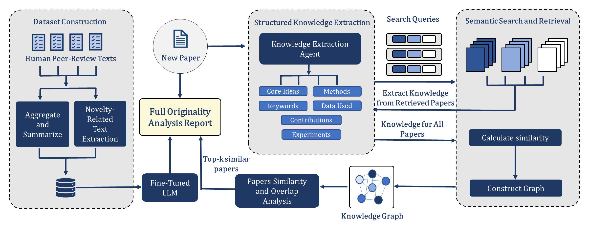

<div align="center">

# Novelty Reviewer

**A large-scale dataset and model for reviewer-aligned novelty assessment of research papers**

[*Are We Truly Innovating? A Qualitative and Quantitative Study of Originality in AI Research Papers*](https://arxiv.org/abs/2602.06054)

[](https://arxiv.org/abs/2602.06054)
[](https://m2l-lab.github.io/Novelty-Reviewer/)
[](https://huggingface.co/AbeerMostafa/Novelty_Reviewer)
[](https://huggingface.co/datasets/AbeerMostafa/Novelty-Reviewer-Dataset)


</div>

Judging novelty is one of the most consequential steps of peer review, and one of the least consistent. This
repository provides three resources for studying and supporting it:

* **Dataset:** 102,021 official reviews of 37,899 ICLR and NeurIPS submissions (2022–2025). Each submission
  comes with the reviewers' novelty statements, a paper-level novelty assessment and a novelty score.
* **Model:** [Novelty Reviewer](https://huggingface.co/AbeerMostafa/Novelty_Reviewer), Llama-3.1-8B-Instruct
  fine-tuned on the dataset. It predicts a novelty score with a reviewer-style justification.
* **Framework:** a retrieval-augmented pipeline that compares a manuscript with related work from Semantic
  Scholar and writes a literature-grounded originality report.

<p align="center"></p>

## Contents

1. [The dataset](#the-dataset)
2. [Installation](#installation)
3. [Quick start](#quick-start)
4. [Tutorials](#tutorials)
5. [Reproducing the paper](#reproducing-the-paper)
6. [Intended use and limitations](#intended-use-and-limitations)
7. [Citation](#citation)

---

## The dataset

| | |
|---|---|
| **Submissions** | 37,899 (ICLR 2022–2025, NeurIPS 2022–2025) |
| **Reviews** | 102,021 official reviews with full text and typed scores |
| **Annotations** | Verbatim novelty excerpts per review; paper-level novelty assessment; novelty score |
| **Splits** | 31,411 train / 6,488 test; 500-paper evaluation subset used in the paper |
| **Privacy** | Author names, e-mail addresses and identifying links removed; no full paper texts |
| **Format** | Parquet, loadable with Hugging Face `datasets` |

Every submission carries an **Expert-Consensus Novelty Alignment (ECNA)**: a score that summarizes how its
reviewers judged its novelty.

| Score | Label | Meaning |
|:---:|---|---|
| −1 | Not novel | Derivative; largely replicates existing approaches |
| 0 | Limited novelty | Minor variations of known methods |
| 1 | Moderately novel | Original, but overlaps notably with prior work or extends existing ideas |
| 2 | Highly novel | Fundamentally new ideas, methods or problem formulations |

### Record structure

| Field | Description |
|---|---|
| `paper_id` | OpenReview id (`https://openreview.net/forum?id=<paper_id>`) |
| `title`, `abstract`, `venue`, `year` | Submission metadata from OpenReview |
| `split`, `in_eval_subset` | Train/test assignment; flag for the 500 papers evaluated in the paper |
| `reviews` | List of reviews: `review_text`, `rating`, `confidence` and venue-specific sub-scores (`soundness`, `contribution`, `technical_novelty_and_significance`, `originality`, …) |
| `review_template` | The venue's review form |
| `novelty_excerpts` | Verbatim passages of the reviews that assess novelty |
| `novelty_score` | ECNA score in {−1, 0, 1, 2} |
| `novelty_score_justification`, `novelty_detailed_assessment` | Paper-level novelty assessment |
| `novelty_summary` | Full generated assessment |

The complete schema, the construction pipeline and known limitations are documented in the
[dataset card](https://huggingface.co/datasets/AbeerMostafa/Novelty-Reviewer-Dataset).

## Installation

```bash
git clone https://github.com/m2l-lab/Novelty-Reviewer.git
cd Novelty-Reviewer
pip install -e .                 # dataset tools only (CPU)
pip install -e ".[model]"        # + Novelty Reviewer inference
pip install -e ".[all]"          # + originality pipeline, evaluation and notebooks
```

The model and the pipeline need a GPU (≥ 24 GB for the 8B model in bf16) and access to
[Llama 3.1](https://huggingface.co/meta-llama/Llama-3.1-8B-Instruct) on Hugging Face (`huggingface-cli login`).

## Quick start

**Load the dataset**

```python
from novelty_reviewer import load_novelty_dataset, eval_subset

ds = load_novelty_dataset()                 # DatasetDict with "train" and "test"
paper = ds["test"][0]
print(paper["title"], paper["novelty_score"], paper["novelty_score_justification"])

benchmark = eval_subset(ds["test"])         # the 500 papers evaluated in the paper
```

The dataset also loads without this package: `datasets.load_dataset("AbeerMostafa/Novelty-Reviewer-Dataset")`.

**Assess the novelty of a paper**

```python
from novelty_reviewer import NoveltyReviewer
from novelty_reviewer.pdf import pdf_to_markdown

reviewer = NoveltyReviewer.from_pretrained()          # AbeerMostafa/Novelty_Reviewer
prediction = reviewer.predict(pdf_to_markdown("paper.pdf"))

print(prediction.score, prediction.label)             # e.g. 1 Moderately novel
print(prediction.review)
```

**Write a literature-grounded originality report**

```python
from novelty_reviewer import OriginalityAnalyzer

analyzer = OriginalityAnalyzer.from_pretrained(share_model=True)   # optional: export S2_API_KEY=...
report = analyzer.analyze(pdf_to_markdown("paper.pdf"), top_k=5)
print(report.to_markdown())        # novelty score, justification and the most similar prior work
report.save("reports/")
```

**Command line**

```bash
novelty-reviewer predict --pdf paper.pdf
novelty-reviewer predict --paper-id <openreview-id>     # downloads the paper from OpenReview
novelty-reviewer analyze --pdf paper.pdf --output reports
```

## Tutorials

| Notebook | Content | Hardware |
|---|---|---|
| [01 · Dataset tour](notebooks/01_dataset_tour.ipynb) | Loading, record anatomy, statistics, reviews, label validity, splits | CPU |
| [02 · Predicting novelty](notebooks/02_predict_novelty.ipynb) | Scoring OpenReview papers and your own PDFs with the model | GPU |
| [03 · Originality reports](notebooks/03_originality_report.ipynb) | Retrieval, knowledge graph and grounded assessment | GPU |
| [04 · Benchmarking a model](notebooks/04_benchmark_a_model.ipynb) | Evaluating any LLM on the evaluation subset with the paper's protocol | GPU |

## Reproducing the paper

[`docs/REPRODUCIBILITY.md`](docs/REPRODUCIBILITY.md) maps every section of the paper to code and lists the
commands for dataset construction, training and evaluation. In short:

```bash
python scripts/evaluation/prepare_paper_texts.py --output data/eval_paper_texts.parquet
python scripts/evaluation/generate_predictions.py --paper-texts data/eval_paper_texts.parquet \
    --model AbeerMostafa/Novelty_Reviewer --prompt novelty_reviewer
python scripts/evaluation/score_predictions.py results/predictions/*/model_results.parquet
```

## Intended use and limitations

The model and framework are **decision-support tools** for reviewers, area chairs and researchers. They are not
automated accept/reject systems. ECNA labels encode reviewer opinion, not ground-truth novelty; they are derived
by an LLM and validated on a sample. The dataset covers English-language machine learning venues. Author identities
and affiliations are not used by the model and are removed from the released data.

## Citation

```bibtex
@misc{mostafa2026novelty,
  title         = {Are We Truly Innovating? A Qualitative and Quantitative Study of Originality in AI Research Papers},
  author        = {Mostafa, Abeer and Nguyen, Thi Huyen and Ahmadi, Zahra},
  year          = {2026},
  eprint        = {2602.06054},
  archivePrefix = {arXiv},
  primaryClass  = {cs.CL},
  url           = {https://arxiv.org/abs/2602.06054}
}
```

## License

| Artifact | License |
|---|---|
| Code (this repository) | [MIT](LICENSE) |
| Dataset | [CC BY-NC 4.0](https://creativecommons.org/licenses/by-nc/4.0/) |
| Model | [Llama 3.1 Community License](https://www.llama.com/llama3_1/license/) |

The dataset contains reviews and abstracts from [OpenReview](https://openreview.net). Their licenses vary by venue
and paper (mostly CC BY 4.0, some CC BY-NC 4.0); CC BY-NC 4.0 covers all of them. When you use the dataset, please
cite the paper and credit OpenReview and the original reviewers and authors. The novelty assessments were generated
with Llama 3.1. The model is built with Llama.

## Acknowledgements

This work was supported by the German Federal Ministry of Research, Technology and Space (EMuLE, 16IS24059), the
Leibniz Young Investigator Grant program (ARENA, LYIG-2023-01) funded by the Lower Saxony Ministry of Science and
Culture (MWK), and the Volkswagen Foundation's Zukunft Niedersachsen program (CAIMed, ZN4257).
